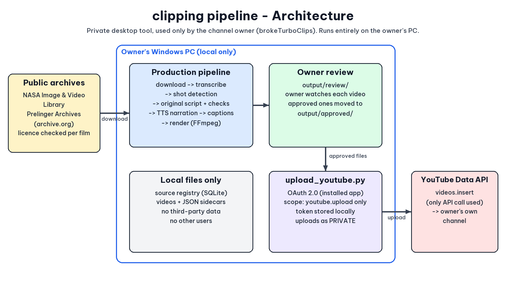

# Clipping Farm

**An automated pipeline that turns licence-checked archival film into narrated YouTube Shorts, with a human approving every upload.**


It started from [MoneyPrinterTurbo](https://github.com/harry0703/MoneyPrinterTurbo) (MIT), which is included unmodified as a submodule and used as a library. The pipeline around it is my own work, about 3,500 lines of Python:

- **Staged pipeline with swappable parts.** Download → transcribe → shot detection → moment selection → script → originality check → narration → captions → render → package. Each stage has a file contract ([`CONTRACTS.md`](CONTRACTS.md)), and the implementation is chosen in [`pipeline.toml`](pipeline.toml). Changing a setting re-runs only that stage and the ones after it. Finished Shorts are frozen.
- **Licence-aware source discovery.** One finder per archive (NASA Images, Prelinger). Each finder checks the rights on the item's own page and rejects third-party or © credits. A Claude call then scores how well each source fits. Attribution text always comes from the registry, never from the model.
- **Runs on a 4 GB GPU.** Every stage runs in its own process, so only one model is ever loaded: faster-whisper for transcription and word alignment, Kokoro ONNX for the voice, and FFmpeg NVENC for rendering.
- **Daily automation.** [`run_daily.py`](run_daily.py) runs discover → produce → cleanup. It's safe to stop and re-run, and it keeps a SQLite registry, a ledger and a log for each day.
- **Human in the loop.** Shorts land in `output/review/`. Only the ones I approve get uploaded, and then only as **private** videos through the YouTube Data API ([`upload_youtube.py`](upload_youtube.py)). [`fetch_analytics.py`](fetch_analytics.py) collects daily statistics into the same database.
- **Music-edit mode.** Reads the public Shorts music chart to pick a style, then uses a *licensed* NoCopyrightSounds track in that style (chart songs are never downloaded) and makes beat-synced cuts from public-domain footage.

<p align="center"></p>

> [!NOTE]
> Windows-first. It expects a portable Python in `runtime/`, a `.venv` built from `requirements.txt` + `constraints.txt`, the models in `models/`, the `claude` CLI on PATH, and your own Google OAuth client in `secrets/` (never committed). Clone with `--recursive` to get MoneyPrinterTurbo.

---

## Operating manual

Everything lives in this folder.

| Folder / file | What it is |
|---|---|
| `runtime\python\` | Portable Python 3.12 (not the system one) |
| `.venv\` | Python packages, incl. CUDA libraries and FFmpeg 7.1 (NVENC) |
| `models\` | AI models (Whisper; later Kokoro) |
| `cache\` | Download caches (pip, Hugging Face) |
| `MoneyPrinterTurbo\` | Stock MoneyPrinterTurbo, unmodified, used as a library |
| `pipeline\` | Our pipeline code |
| `pipeline\stages\<stage>\` | One folder per stage; each `.py` inside is a swappable implementation |
| `pipeline.toml` | Picks the implementation + settings for every stage |
| `CONTRACTS.md` | The files each stage reads and writes |
| `prompts\` | Claude prompts (editable .md) |
| `work\` | Registry database and per-source / per-short working files |
| `output\review\`, `output\approved\` | Finished Shorts |

### Daily use (PowerShell, from this folder)

```
cd D:\dev\clipping_farm
python run_daily.py --count 3          # make 3 Shorts today (safe to stop and re-run)
```
1. Watch the videos in `output\review\`.
2. Move the good ones (the `.mp4` AND its `.json`) to `output\approved\`.
3. `python upload_youtube.py --dry-run` to see what would be uploaded, then
   `python upload_youtube.py` to upload them as **private** videos.
   Uploaded files move to `output\uploaded\`.

Log of each day: `work\logs\<date>.log`. Progress: `work\runs\<date>.json`.

### YouTube upload: one-time setup
1. Go to https://console.cloud.google.com/ and create a project (any name).
2. "APIs & Services" > "Library" > search **YouTube Data API v3** > Enable.
3. "APIs & Services" > "OAuth consent screen": choose **External**, fill in the app name and
   your email, and under "Test users" add the Google account that owns the channel.
4. "APIs & Services" > "Credentials" > "Create credentials" > "OAuth client ID" >
   Application type **Desktop app** > Create > **Download JSON**.
5. Save that file as `D:\dev\clipping_farm\secrets\client_secret.json`.
6. Run `python upload_youtube.py`. A browser opens once to sign in; after that it remembers you.

Notes: the API allows about 6 uploads per day. Videos uploaded through an API project that
Google has not audited stay locked to private; that is fine for review, but to publish them
you either request Google's API audit or upload the final versions in YouTube Studio.

### Advanced commands

```
.\.venv\Scripts\python.exe -m pipeline sources                 # show approved sources
.\.venv\Scripts\python.exe -m pipeline stages                  # show stages + implementations
.\.venv\Scripts\python.exe -m pipeline source <source_id>      # download, transcribe, detect shots
.\.venv\Scripts\python.exe -m pipeline status <source_id>      # what is done / needs re-running
.\.venv\Scripts\python.exe -m pipeline run <stage> <id> --force   # force one stage to re-run
```

### How it fits together (all plug-ins, all chosen in pipeline.toml)
- **Daily jobs** (`pipeline\daily\`): `discover` → `produce` → `cleanup`. Add a job = add a file + list it.
- **Finders** (`pipeline\discover\finders\`): one per archive (NASA, Prelinger). They search, verify the
  licence on each item's own page, check length/content, and a **scorer** (one Claude call) rates the fit.
  Good ones are added to the registry automatically (`added_by = auto:<finder>`).
  Run by hand: `.\.venv\Scripts\python.exe -m pipeline discover`.
- **Stages** (`pipeline\stages\`): download → transcribe → shots → describe → select → script → check
  (per source), then narrate → captions → render → package (per Short).
- **Cleanup**: once all of a source's Shorts are made, its video is deleted and it is marked `used`.
  Finished Shorts are frozen: later setting changes never alter them.

### Changing a stage
- **Tweak it:** edit its block in `pipeline.toml`. Only that stage and later ones re-run.
- **Replace it:** add `pipeline\stages\<stage>\<new_name>.py` with a `run(unit, cfg)` function that
  writes the files listed in `CONTRACTS.md`, then set `impl = "<new_name>"` in `pipeline.toml`.
  The old version stays in place, so switching back is one line.
